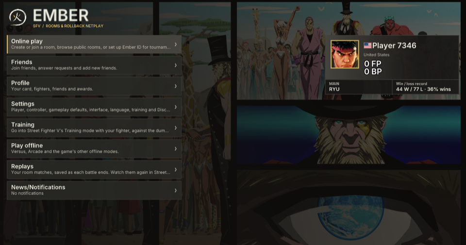
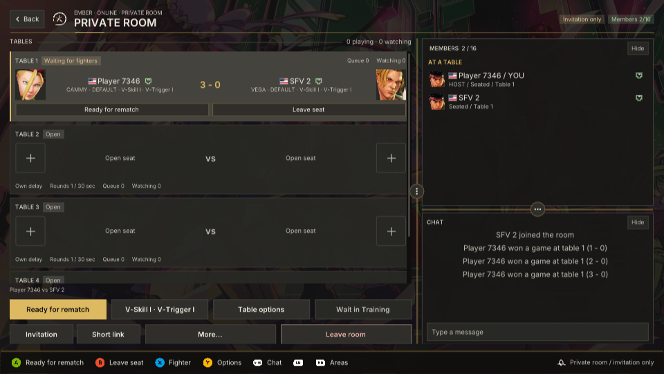
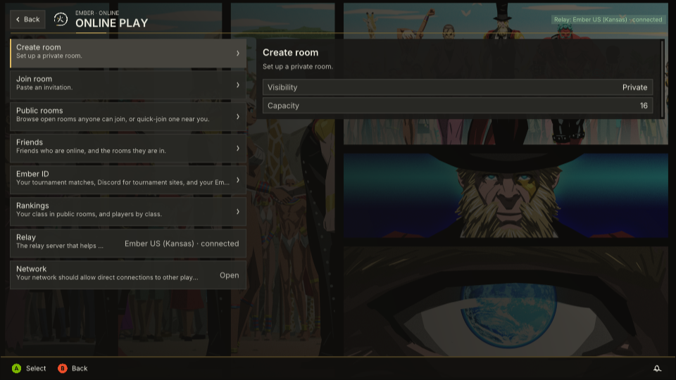
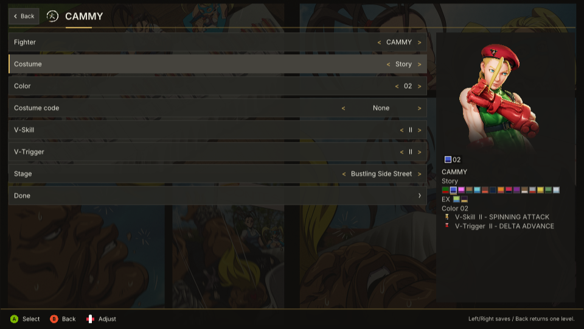
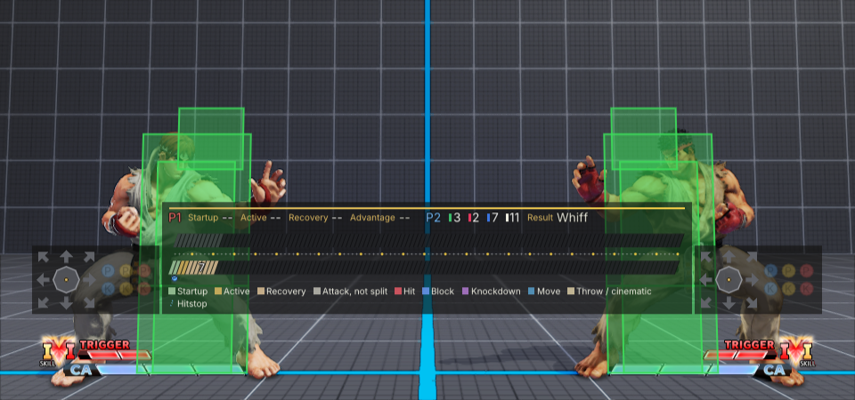
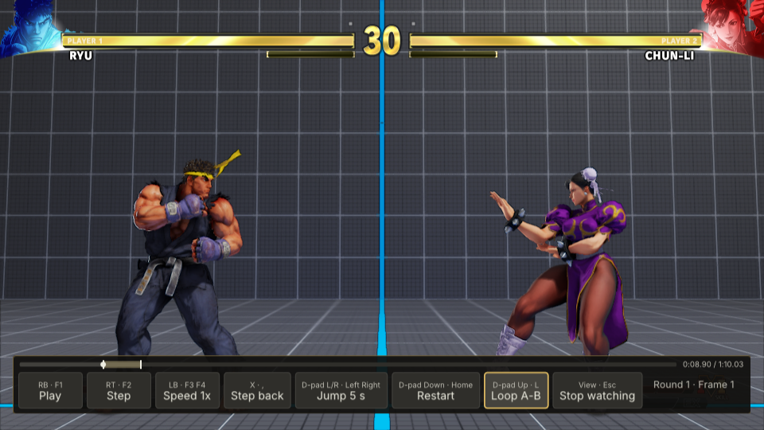

# SFV Ember

Rollback netplay for Street Fighter V on Steam, built on
[Ember](https://github.com/Confetti3/SF4-Ember-Netplay), the netcode of SF4
Ember. Unofficial and not affiliated with Capcom.

The game never talks to Capcom: the mod blocks every connection except
loopback and the room's own players, before any game code runs. SFV's own
online modes stay closed.

## Play

1. Download the newest `sfv-ember-<version>.zip` from
   [Releases](https://github.com/Confetti3/SFV-Ember/releases).
2. Extract it anywhere outside the game's folder.
3. Keep Steam running and double-click **Launcher.exe**. Press **F10** or
   **Start** in the game to open SFV Ember.

`START_HERE.md` in the package has the details. Both players need the same SFV
Ember release.

## What it has



Press **F10** or **Start** anywhere in the game and SFV Ember opens over it:
rooms, friends, your profile, settings, Training, replays and news, drawn in
the game's own window.

### Rooms with rollback netplay



- Private rooms for up to 16 players, with tables, a queue, spectators,
  rematches and chat. Invite by link or short code, or let friends join from
  their list.
- Public rooms near you, Quick join, and Arcade and King of the Hill tables.
- Rollback netcode from Ember, the netcode of SF4 Ember. Before the first
  frame, both games check that they have the same balance version and the
  same game data for each fighter; if a mod or a damaged file makes them
  differ, the match ends at once and the notice names the fighter, instead of
  desyncing mid-fight.
- Relays for players whose network blocks a direct connection.



### Every fighter, costume and stage



- Every player has every fighter, costume, colour and stage the game has
  installed, in SFV's own modes as well as in rooms: Capcom's servers, which
  told the game what each account owns, no longer answer. Stages one player
  lacks on disk are left out of the stage choice; Random stage picks from
  stages both have.
- Fighter select laid out like SFV's own, with pictures of every costume,
  V-Skill and V-Trigger cards that say what each one does, and stage pictures.
  Each fighter remembers its own look.

### Training



Ember's Training tools over SFV's own Training battle:

- A frame meter with startup, active, recovery and advantage, in three styles,
  and input displays for both players.
- Hitboxes and hurtboxes.
- Dummy recording in eight slots (played once or looped, in order or at
  random, mirrored, saved by name) and dummy reply after hit, after block or
  on wake-up, with timing and chance.

**F6** opens the controls, **F7** records, **F8** plays and **F5** hides the
HUD.

### Replays



Every room match is saved as it ends. Watch it again with pause, frame step,
step back, slow motion, 5-second jumps, restart and an A-B loop, with a
timeline that shows where you are.

### And more

- Player cards and profiles, Find a player, points and tiers, and awards.
- Friends shared with SF4 Ember: one friend list, one friend code and one
  Appear offline for both games.
- PlayStation, Switch and DirectInput pads work without Steam Input: SFV
  Ember's controller layer reads them with SDL3 and gives them to the game as
  XInput pads, in slots no Xbox-style pad holds. `"controllerLayer": false` in
  `%APPDATA%\SFVEmber\settings.json` turns it off.
- Linux and Steam Deck under Proton.
- The Discord companion, in-app updates from this repository's releases, and
  the interface in 14 languages.

Known limits: Ember's menus and its battles follow the pad in the game's first
slot, or the keyboard when no pad is there; the frame meter is in Training only; non-English translations are drafts.

## Build

Needs Visual Studio 18 Build Tools (C++ x64), a vcpkg checkout next to this
folder (`..\vcpkg`), and the Ember library: the `feat/ember-library` branch of
[SF4-Ember-Netplay](https://github.com/Confetti3/SF4-Ember-Netplay). This
release builds against library commit `50e3f7420`.

```powershell
git clone -b feat/ember-library https://github.com/Confetti3/SF4-Ember-Netplay ember-library
git -C ember-library checkout 50e3f7420
.\scripts\build.ps1 -EmberRoot ..\ember-library
```

`scripts/build.ps1` builds and runs the tests; `-Player` makes a player build,
which `scripts/package.ps1` packages. Design notes are in
[docs/design/EMBER_LIBRARY.md](docs/design/EMBER_LIBRARY.md) and
[docs/design/SFV_PORT.md](docs/design/SFV_PORT.md).

## Thanks

Some fixes in SFV Ember were found by reading the published source and notes of
[Polarity](https://github.com/polarityproject/polarity-client), the other SFV rollback mod, by
polarityproject. They pointed us at the game's login check, which runs with no guard
against an online service that is not there; the XInput proxy being re-entered by hooking tools;
game state a save left out (a fighter's effect switches, the round-end state); each fighter's own
balance version; and listing the mod paks. We re-checked each one in our own copy of the game and
wrote our own fix. Thank you.

## Licence

MIT (`LICENSE`). Ember's own licence and the third-party notices ship in each
package's `notices` folder. Street Fighter V is Capcom's; this project ships
none of its files.
